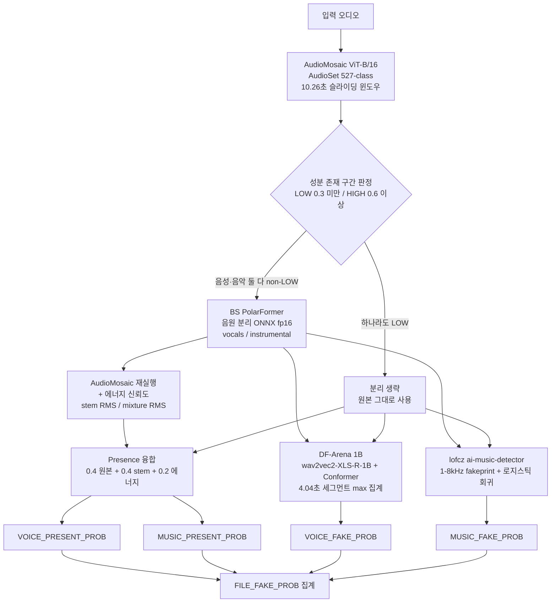
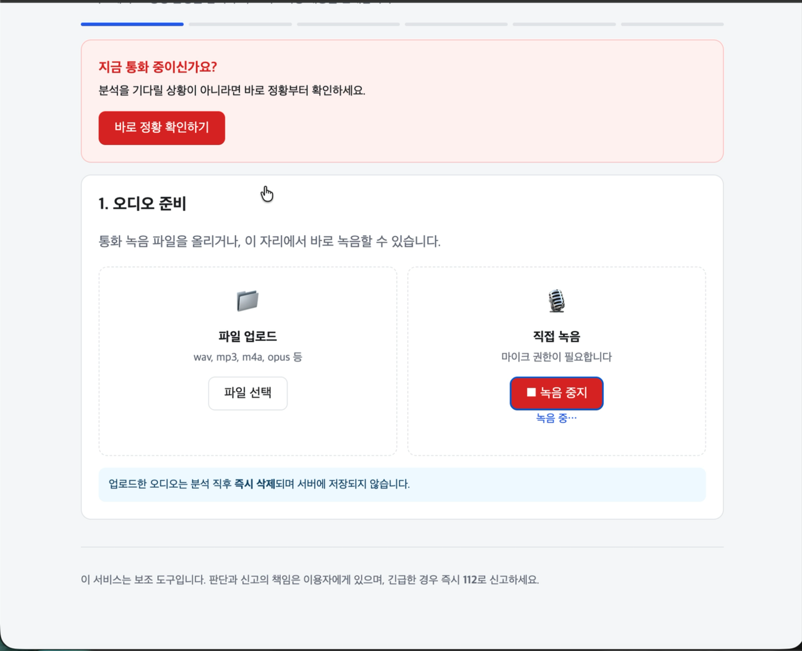

# 26-2 DSL Modeling · Multimodal

AI 생성 오디오 탐지 프로젝트. 하나의 오디오에서 **음성·음악 성분을 분리해 각각이 AI로
생성되었는지 판정**하고, 그 결과를 보이스피싱 대응 흐름으로 연결하는 웹 데모까지 포함한다.

DACON 「AI Deepvoice Detection Challenge」(236749) 출품작이며, 평가 지표는
파일/음성/음악 단위 EER과 성분 존재 판별 ROC-AUC의 가중합이다.

---

## 저장소 구조

```
26-2_DSL_Modeling_Multimodal/
│
├── data_preprocessing/            ① 데이터 — 원본 오디오를 학습용 혼합 데이터셋으로
│   ├── v1_preprocess_data.ipynb        노트북 단계의 초기 전처리
│   ├── v2_preprocess_data.py           스크립트화 + 청크 정책 분리
│   ├── v3_preprocess_data.py           4초 미만 청크 필터링
│   ├── v4_data_cleaning.py             보컬 섞인 MUSAN 음악 제거
│   ├── v5_data_cleaning.py             배경잡음 버전으로 일부 교체
│   └── README.md
│
├── spoof_detection_training/      ② 모델 (자체 학습) — AST · AASIST
│   ├── ast/                            VP/MP 성분 존재 판별 모델
│   ├── aasist/                         VF/MF/FF 딥페이크 탐지 모델
│   ├── common.py                       두 학습 파이프라인 공통 코드
│   └── README.md
│
├── dacon_submission/              ② 모델 (최종 제출) — 사전학습 모델 4종 조합
│   ├── script.py                       배치 추론 엔트리포인트
│   ├── src/                            탐지 파이프라인 본체
│   │   ├── audio_presence.py               AudioMosaic 성분 검출
│   │   ├── separator.py                    BS PolarFormer 음원 분리
│   │   ├── music_routing.py                분리 실행 여부 라우팅
│   │   ├── voice_fake_detector.py          DF-Arena 1B 음성 판정
│   │   ├── music_fake_lofcz.py             lofcz 음악 판정
│   │   ├── artifactnet.py                  ArtifactNet 음악 판정 (대안)
│   │   └── pipeline.py                     전체 조립
│   └── model/                          모델 설정 (가중치는 미포함)
│
├── web_demo/                      ③ 웹 — 업로드·녹음 → 분석 → 보이스피싱 대응
│   ├── backend/                        FastAPI 서버
│   ├── frontend/                       HTML · CSS · JS (외부 의존성 없음)
│   ├── pipeline_src/src/               탐지 파이프라인 번들
│   └── slurm/                          계산 노드 실행 스크립트
│
└── docs/demo.mp4                  웹 데모 시연 영상
```

---

## ① 데이터

성분별 라벨(음성 존재·음악 존재·음성 가짜·음악 가짜)이 필요한 과제라, **음성과 음악을
직접 혼합해 라벨을 통제한 데이터셋**을 만들었다. v1부터 매번 새로 만들지 않고 **이전
버전 결과물 위에 특정 문제만 고치는 방식**으로 진행해, 각 버전이 하나의 문제에 대응한다.

| 버전 | 핵심 변경 | 해결한 문제 |
|---|---|---|
| v1 | 노트북 기반 초기 전처리 | 원본 오디오 → 표준 청크 |
| v2 | 스크립트화, 청크 정책 명시 | 재현성 확보 |
| v3 | 4초 미만 청크 필터링 | 모델 입력 길이에 못 미치는 조각 제거 |
| v4 | 보컬 섞인 MUSAN 음악 제거 | **"음악" 라벨에 사람 목소리가 섞여 라벨이 오염** |
| v5 | 일부를 배경잡음 버전으로 교체 | 깨끗한 혼합만 학습해 실제 환경에 취약해지는 문제 |

v4가 특히 중요하다. MUSAN music에 보컬 트랙이 포함된 파일이 있어서, "음악만 있고
음성은 없음"으로 라벨링한 샘플에 실제로는 사람 목소리가 들어 있었다. 이대로 학습하면
성분 존재 판별이 정면으로 깨진다.

출력은 `mixed_chunks_*.csv` 매니페스트로, 각 행이 혼합 결과 1개와 그 출처
(음성 소스·음악 소스·게인·클리핑 정보)를 담는다. 서브셋 샘플은
`spoof_detection_training/*/subsets/`에 포함되어 있다.

---

## ② 모델

두 갈래로 진행했다. **자체 학습 트랙**(AST·AASIST)과 **사전학습 모델 조합
트랙**이며, 최종 제출은 후자를 채택했다.

### 최종 제출 파이프라인



**집계식** — 존재 확률을 그대로 곱하면 "존재가 이미 확실한" 파일까지 점수가 깎여
순위가 뒤집힌다. 임계값 이상이면 가중치를 1.0으로 올림해 이를 막았고, 음성과 음악의
탐지기 품질이 달라 임계값을 따로 두었다.

```
r_voice(p) = 1.0 if p >= 0.2 else p
r_music(p) = 1.0 if p >= 0.3 else p

FILE_FAKE_PROB = max( r_voice(VP) x VF,  r_music(MP) x MF )
```

### 구성 요소

| 역할 | 모델 | 비고 |
|---|---|---|
| 성분 존재 검출 | AudioMosaic ViT-B/16 (AudioSet) | 527개 클래스를 음성군/음악군으로 묶어 집계 |
| 음원 분리 | BS PolarFormer (ONNX fp16) | 44.1kHz 스테레오. `instrumental = mixture − vocals` |
| 음성 딥페이크 | DF-Arena 1B | wav2vec2-XLS-R-1B + Conformer, 16kHz |
| 음악 딥페이크 | lofcz ai-music-detector | 보코더의 전치합성곱 흔적을 스펙트럼에서 탐지 |
| 음악 딥페이크 (대안) | ArtifactNet v9.4 | 비교 실험용으로 코드 유지 |

### 주요 설계 판단

- **분리를 조건부로 실행한다.** 항상 분리하면 파일당 처리 시간이 ~4초로 늘어
  전체 실행이 제한 시간을 넘긴다. 성분 하나가 확실히 없으면 간섭도 없으므로
  분리 없이 원본을 그대로 쓴다.
- **존재 확률이 낮아도 탐지기를 건너뛰지 않는다.** "확실히 없음"으로 판정된
  성분의 탐지를 생략하고 중립값 0.5를 넣었더니 점수가 떨어졌다. 존재 판정이
  틀렸을 때 중립값은 복구가 불가능하지만, 빗나간 실제 점수는 그렇지 않다.
- **음악 판정에 Platt 보정을 적용한다** (`scale 0.142962 / bias 3.097933`).
  단조 변환이라 음악 EER 자체는 바뀌지 않지만, `max()` 경쟁에서 음성 점수와
  겨루는 위치가 달라진다.
- **DF-Arena 침묵 게이트를 RMS 1e-3으로 올렸다.** 분리된 vocals stem이 거의
  무음인 경우(음악만 있는 파일) 의미 없는 점수가 나오는 것을 차단한다.

### 자체 학습 트랙

`spoof_detection_training/`에 AST(성분 존재)와 AASIST(딥페이크 탐지) 학습
파이프라인이 있다. 위 혼합 데이터셋으로 학습했으며, SLURM 작업 스크립트와
서브셋 매니페스트를 포함한다.

---

## ③ 웹 데모

오디오를 올리거나 바로 녹음하면 분석하고, 보이스피싱 정황 확인부터 신고용 정보
정리까지 이어지는 FastAPI 웹 애플리케이션.

[](docs/demo.mp4)

**▶ [시연 영상 보기 (1분)](docs/demo.mp4)** — 업로드부터 신고용 정보 정리까지 전 과정

### 흐름

```
업로드 / 녹음
     │
     ├─────────────┬──────────────────┐
     ▼             ▼                  │  분석을 기다리는 동안
  모델 분석    정황 체크리스트          │  체크리스트를 작성한다
 (백그라운드)  (돈 요구? 기관 사칭?)    │
     │             │                  │
     └──────┬──────┘                  │
            ▼
      종합 판단 (정황 + 모델)
            │
            ▼
      피해 발생 여부
            │
     ┌──────┴───────┐
     ▼              ▼
  긴급 대응       예방 안내
  지급정지·112
     └──────┬───────┘
            ▼
   신고용 정보 정리 (복사 / 저장)
```

### 설계 원칙

이 데모는 **금전 피해와 직결되는 판단**을 다루므로 다음을 지켰다.

1. **정황 체크리스트가 1차 근거, 모델은 보조 지표.** 행동 신호(안전계좌 요구,
   원격제어 앱 설치 유도 등)가 모델 점수보다 신뢰도가 높다.
2. **낮은 확률에 "안전"이라고 쓰지 않는다.** 모델은 위험 등급을 올릴 수는 있어도
   내릴 수는 없도록 구현했다.
3. **분석 대기 시간에 체크리스트를 받는다.** 대기가 유용해지고, 사용자가 모델
   점수를 보기 전에 답하므로 결과에 끌려가는 편향도 막는다.
4. **자동으로 신고하지 않는다.** 오탐 시 허위신고가 되고, 실제 신고는 본인
   진술이 필요하다. 정보 정리까지가 도구의 범위다.
5. **오디오를 저장하지 않는다.** 임시 파일로 받아 분석 직후 삭제한다.
6. **외부 CDN에 의존하지 않는다.** 네트워크가 끊겨도 화면이 그대로 동작한다.

### 실행

```bash
pip install -r web_demo/backend/requirements.txt
```

```bash
cd web_demo/backend && uvicorn main:app --port 18342
```

<http://localhost:18342> 접속. 모델 없이 UI만 확인하려면 `ANALYZER_MODE=dummy`(기본값),
실제 모델을 연결하려면 `ANALYZER_MODE=model`과 가중치 경로 환경변수가 필요하다
(`web_demo/backend/run_on_slurm.sh` 참고).

> 브라우저 녹음은 보안 정책상 **HTTPS 또는 localhost**에서만 동작한다. 원격
> 서버에서 실행할 경우 SSH 포트 포워딩으로 localhost에 접속하면 된다.

---

## 저장소에 포함하지 않은 것

모델 가중치(`.pt`, `.bin`, `.safetensors`, `.onnx`, 수백MB~4.3GB), 학습 체크포인트,
Hugging Face 캐시, 실행 로그는 용량 때문에 제외했다. 각 모듈의 `README.md`에 원본
경로와 구성이 설명되어 있다.

클러스터 계정명과 절대경로는 공개를 위해 플레이스홀더(`/cluster/workspace/...`)로
치환했다. 다른 환경에서 실행하려면 해당 접두사만 바꾸면 된다.
